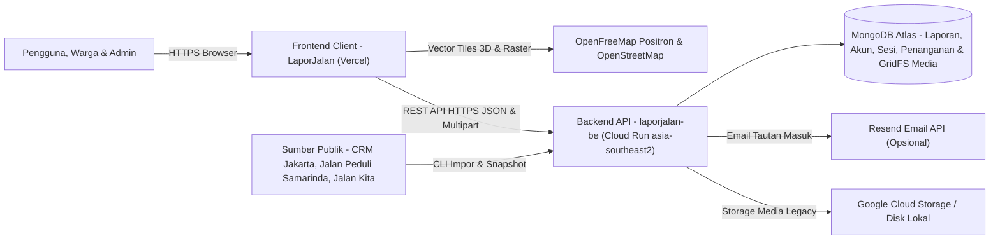

# LaporJalan - Backend API Service

Layanan backend REST API berbasis Node.js, Express, dan TypeScript untuk platform **LaporJalan**. Menangani penyajian snapshot laporan publik multi-sumber, autentikasi dan sesi akun warga, penerimaan laporan beserta sanitasi bukti foto/video, antrean penanganan admin, serta skrip CLI pengumpulan data laporan jalan.

**URL Layanan Produksi (Cloud Run)**: [https://laporjalan-be-710000917298.asia-southeast2.run.app](https://laporjalan-be-710000917298.asia-southeast2.run.app)  
**Health Check API**: [https://laporjalan-be-710000917298.asia-southeast2.run.app/health](https://laporjalan-be-710000917298.asia-southeast2.run.app/health)  
**Frontend Produksi (Vercel)**: [https://lapor-jalan-two.vercel.app](https://lapor-jalan-two.vercel.app)  
**Repositori Frontend**: [https://github.com/Vereniaes/LaporJalan](https://github.com/Vereniaes/LaporJalan)

---

## Daftar Isi

- [Konteks Kompetisi (WIA - MIA 2026)](#konteks-kompetisi-wia---mia-2026)
- [Koneksi Layanan & Arsitektur Sistem](#koneksi-layanan--arsitektur-sistem)
- [Arsitektur Endpoint & Keamanan](#arsitektur-endpoint--keamanan)
- [Koleksi MongoDB](#koleksi-mongodb)
- [Tech Stack](#tech-stack)
- [Struktur Repositori](#struktur-repositori)
- [Instalasi & Pengembangan Lokal](#instalasi--pengembangan-lokal)
- [Skrip Operasional (CLI)](#skrip-operasional-cli)
- [Skrip NPM & Pengujian](#skrip-npm--pengujian)
- [Panduan Deployment (Google Cloud Run)](#panduan-deployment-google-cloud-run)
- [Progress Saat Ini & Roadmap Backend](#progress-saat-ini--roadmap-backend)
- [Tim Pengembang](#tim-pengembang)
- [Hak Cipta](#hak-cipta)

---

## Konteks Kompetisi (WIA - MIA 2026)

Repositori backend **laporjalan-be** merupakan layanan API inti platform **LaporJalan** yang dikembangkan untuk kompetisi **Web In Action (WIA)** pada rangkaian **Multimedia In Action (MIA) 2026** oleh **KSM Multimedia UPN Veteran Jakarta**.

- **Tema Kompetisi**: *Designing Digital Futures - Powering Public Transparency*
- **Subtema Terpilih**:
  - **Civic Reporting & Accountability** - Penyimpanan laporan warga, pembaruan kondisi, dan audit publikasi berbasis revisi.
  - **Open Government Data** - Agregasi, normalisasi, dan anonimisasi data laporan jalan dari sumber publik pemerintah.
  - **Public Service Tracking** - Pencatatan status penanganan terpisah dari sumber asli pada koleksi `report_handling` oleh pengelola.

---

## Koneksi Layanan & Arsitektur Sistem

Service backend ini di-deploy pada container **Google Cloud Run (`asia-southeast2`)** dan melayani permintaan dari aplikasi frontend [**LaporJalan**](https://github.com/Vereniaes/LaporJalan) yang berjalan di **Vercel** (`https://lapor-jalan-two.vercel.app`). Kebijakan penulisan data dibatasi menggunakan `APP_ORIGIN` dan `CORS_ORIGIN` ([`src/app.ts`](./src/app.ts), [`src/community/index.ts`](./src/community/index.ts)).

| Komponen | URL / Lokasi | Repositori |
| --- | --- | --- |
| **Backend REST API (Cloud Run)** | [https://laporjalan-be-710000917298.asia-southeast2.run.app](https://laporjalan-be-710000917298.asia-southeast2.run.app) | [Vereniaes/laporjalan-be](https://github.com/Vereniaes/laporjalan-be) |
| **Frontend Client (Vercel)** | [https://lapor-jalan-two.vercel.app](https://lapor-jalan-two.vercel.app) | [Vereniaes/LaporJalan](https://github.com/Vereniaes/LaporJalan) |



---

## Arsitektur Endpoint & Keamanan

### 1. Endpoint Publik (Aktif pada semua mode)

- `GET /` - Metadata API dan indeks rute aktif sesuai konfigurasi `PUBLIC_REPORTS_ONLY`.
- `GET /health` - Probe kesiapan layanan (`status`, `service`, `uptime`, `timestamp`, `mode`, `community`, dan status `database`).
- `GET /api/public-reports` - Mengembalikan snapshot laporan publik dari koleksi `imported_reports` di MongoDB dengan fallback langsung ke sumber publik bila snapshot database belum tersedia ([`src/routes/publicReportRoutes.ts`](./src/routes/publicReportRoutes.ts)).
- `GET /api/public-reports/:id` - Detail satu laporan impor beserta riwayat tindak lanjut.
- `GET /api/public-reports/:id/handling` - Status dan riwayat penanganan publik oleh pengelola LaporJalan.

### 2. Endpoint Komunitas, Akun & Admin (`/api/community`)

Aktif apabila `COMMUNITY_REPORTS_ENABLED=true`, koneksi `MONGODB_URI` terhubung, serta `APP_ORIGIN` terkonfigurasi untuk permintaan tulis (`POST`/`PATCH`):

- `GET /api/community/capabilities` - Status kesiapan baca, tulis, login, tautan email, dan layanan analisis berdasarkan header `Origin`.
- **Autentikasi ([`src/community/auth.ts`](./src/community/auth.ts))**:
  - `POST /api/community/auth/register` - Pendaftaran akun baru (hash kata sandi `scrypt` dengan salt acak per akun; pembatasan 5 kali/jam per email).
  - `POST /api/community/auth/login` - Login email + kata sandi dengan verifikasi waktu-konstan `timingSafeEqual` (batas 10 percobaan/15 menit per email).
  - `POST /api/community/auth/link` & `POST /api/community/auth/exchange` - Autentikasi tautan email sekali pakai via Resend API bila `RESEND_API_KEY` & `EMAIL_FROM` tersedia.
  - `GET /api/community/auth/session`, `PATCH /api/community/auth/profile`, `POST /api/community/auth/logout` - Sesi token `Bearer` berlaku 7 hari (disimpan dalam bentuk hash SHA-256).
- **Laporan Warga ([`src/community/reports.ts`](./src/community/reports.ts))**:
  - `GET /api/community/reports`, `GET /api/community/reports/:id`, `GET /api/community/reports/:id/media/:mediaId` - Akses daftar, detail, dan streaming lampiran media laporan publik maupun laporan pribadi.
  - `POST /api/community/reports` - Pembuatan laporan warga baru (validasi koordinat Indonesia, idempoten lewat UUID `requestId`, maks. 3 file foto/video @ 10 MB dalam format JPEG, PNG, WebP, MP4, WebM yang diproses ulang untuk menghapus metadata EXIF).
  - `POST /api/community/reports/:id/updates`, `PATCH /api/community/reports/:id/publication` - Menambah riwayat observasi serta mengatur nama pelapor, visibilitas (`public` / `withdrawn`), atau penarikan lampiran dengan kontrol revisi atomik.
- **Analisis Kondisi ([`src/community/analyses.ts`](./src/community/analyses.ts))**:
  - `GET /`, `POST /`, `GET /:analysisId`, `POST /:analysisId/cancel`, `POST /:analysisId/reject` - Manajemen peninjauan analisis kondisi pada laporan warga.
- **Panel Admin ([`src/community/admin.ts`](./src/community/admin.ts), khusus `role: 'admin'`)**:
  - `GET /api/community/admin/summary`, `GET /api/community/admin/reports`, `GET /api/community/admin/units` - Statistik antrean, daftar laporan gabungan (`warga` + `impor`), dan daftar unit kerja.
  - `GET /api/community/admin/reports/:kind/:id`, `POST /api/community/admin/reports/:kind/:id/actions` - Detail lengkap serta aksi penanganan (`status`, `assign`, `hide`, `show`, `duplicate`, `unduplicate`).

### 3. Rute Legacy Opsional (`PUBLIC_REPORTS_ONLY=false`)

- `/api/reports`, `/api/cctv`, `/api/traffic`, `/api/places` ([`src/app.ts`](./src/app.ts)). Pada rilis produksi saat ini (`PUBLIC_REPORTS_ONLY=true`), rute legacy tersebut dinonaktifkan.

---

## Koleksi MongoDB

- `imported_reports` - Hasil impor dan normalisasi laporan publik lintas sumber.
- `citizen_accounts`, `citizen_sessions`, `citizen_links`, `citizen_limits` - Akun pengguna/admin, hash sesi aktif, token tautan email TTL, serta pembatasan laju permintaan (`limit()`).
- `citizen_reports` & `citizen_analyses` - Data laporan warga, riwayat observasi, audit publikasi, dan tugas analisis kondisi.
- `report_handling` - Status dan riwayat penanganan oleh pengelola LaporJalan (terpisah agar pembaruan skrip impor tidak menimpa tindakan admin).
- GridFS `citizen_media` - Penyimpanan foto/video terproses ([`src/community/media.ts`](./src/community/media.ts)).

---

## Tech Stack

| Kategori | Teknologi |
| --- | --- |
| **Runtime & Bahasa** | Node.js 22+ / 24 LTS, TypeScript 5.6 (`tsx` untuk eksekusi lokal) |
| **Web Framework** | Express 4.21 & CORS |
| **Database** | MongoDB Atlas via Mongoose 8.7 (+ MongoDB GridFS) |
| **Pemrosesan Media** | Multer 2.5, Sharp 0.35, FFmpeg (di container produksi Alpine) |
| **Penyimpanan Objek Legacy** | Google Cloud Storage (`@google-cloud/storage`) |
| **Layanan Email Opsional** | Resend REST API |
| **Container & Hosting** | Docker multi-stage build, Google Cloud Run (`asia-southeast2`) |
| **Pengujian** | Node.js native test runner (`node:test` + `tsx`) |

---

## Struktur Repositori

```text
laporjalan-be/
├── scripts/                # Skrip CLI impor data publik (CRM, Samarinda, Jalan Kita) & pemberian peran admin
├── src/
│   ├── community/          # Modul inti komunitas: auth, reports, admin, analyses, media, mediaProcessor, handling, db
│   ├── config/             # Parsing variabel lingkungan (env.ts)
│   ├── controllers/        # Controller untuk rute legacy saat PUBLIC_REPORTS_ONLY=false
│   ├── models/             # Skema dan model Mongoose
│   ├── routes/             # Rute publik (/health, /api/public-reports) & rute legacy
│   ├── services/           # Importer data publik, adapter storage GCS, dan pembaca snapshot
│   ├── app.ts              # Konfigurasi middleware CORS, mounting rute, dan error handler
│   └── index.ts            # Titik masuk HTTP server
├── tests/                  # 12 suite unit test & integration test berbasis node:test
├── .dockerignore           # Pengecualian berkas rahasia & lokal dari context Docker build
├── .env.example            # Template konfigurasi variabel lingkungan
├── .gitignore              # Pengecualian .env, .env.import-salt, node_modules, dist, uploads
├── Dockerfile              # Image produksi multi-stage (Node 22 Alpine + FFmpeg)
├── package.json            # Dependensi & skrip build/dev/start
└── tsconfig.json           # Konfigurasi compiler TypeScript
```

---

## Instalasi & Pengembangan Lokal

### 1. Prasyarat

- **Node.js** versi LTS (`20.x` atau `24.x`)
- **npm** versi `10.x`
- **MongoDB** (Atlas atau lokal) apabila mengaktifkan fitur komunitas, admin, dan penyimpanan snapshot impor.

### 2. Clone dan Pemasangan Dependensi

```bash
git clone https://github.com/Vereniaes/laporjalan-be.git
cd laporjalan-be
npm install
```

### 3. Konfigurasi Lingkungan

Salin template variabel lingkungan:

```bash
cp .env.example .env
```

Untuk menyambungkan dengan frontend lokal (`http://localhost:3000`) dan fitur warga aktif, sesuaikan `.env`:

```env
PORT=5000
NODE_ENV=development
PUBLIC_REPORTS_ONLY=true
COMMUNITY_REPORTS_ENABLED=true
MONGODB_URI=mongodb://localhost:27017/laporjalan
APP_ORIGIN=http://localhost:3000
CORS_ORIGIN=*
```

| Variabel | Deskripsi | Penyimpanan Disarankan |
| --- | --- | --- |
| `PORT` | Port HTTP server (`5000` lokal, `8080` Cloud Run) | Env biasa |
| `NODE_ENV` | Mode runtime (`development`, `production`, `test`) | Env biasa |
| `PUBLIC_REPORTS_ONLY` | Menonaktifkan rute legacy (`/api/reports`, `/api/cctv`, dll.) bila `true` | Env biasa |
| `COMMUNITY_REPORTS_ENABLED` | Mengaktifkan rute `/api/community/*` bila `true` | Env biasa |
| `APP_ORIGIN` | Origin resmi frontend (pisahkan dengan koma bila lebih dari satu) | Env biasa |
| `CORS_ORIGIN` | Origin yang diizinkan CORS atau `*` | Env biasa |
| `MONGODB_URI` | Connection string MongoDB Atlas / lokal | Secret Manager / `.env` |
| `GCP_PROJECT_ID` | ID proyek Google Cloud Platform | Env biasa |
| `GCS_BUCKET_NAME` | Nama bucket GCS untuk upload mode legacy (opsional) | Env biasa |
| `RESEND_API_KEY` | API key Resend untuk login tautan email (opsional) | Secret Manager / `.env` |
| `EMAIL_FROM` | Alamat pengirim terverifikasi Resend | Env biasa |
| `GOOGLE_MAPS_API_KEY` | API key Google Places untuk rute legacy `/api/places` (opsional) | Secret Manager / `.env` |

### 4. Menjalankan Server Lokal

```bash
npm run dev
```

Server berjalan secara default di `http://localhost:5000` dengan probe kesehatan di `http://localhost:5000/health`.

---

## Skrip Operasional (CLI)

Jalankan dari root direktori `laporjalan-be/` menggunakan konfigurasi `.env` aktif:

| Perintah | Fungsi |
| --- | --- |
| `npx tsx scripts/import-crm.ts [--days 30] [--dry]` | Mengimpor laporan publik CRM Jakarta dalam rentang hari terakhir ke `imported_reports` (menyimpan salt hash lokal di `.env.import-salt` yang terabaikan Git). |
| `npx tsx scripts/import-samarinda.ts [--dry]` | Mengimpor titik laporan publik Jalan Peduli Kota Samarinda tanpa menyimpan data pribadi pelapor. |
| `npx tsx scripts/grab-sources.ts [--dry] [--only samarinda\|jalankita]` | Mengambil laporan publik luar Jakarta, membuang data identitas pribadi, dan melabeli sesuai kategori LaporJalan. |
| `npx tsx scripts/make-admin.ts <email> [--remove]` | Memberikan atau mencabut hak `admin` pada akun terdaftar di koleksi `citizen_accounts`. |

---

## Skrip NPM & Pengujian

| Perintah | Fungsi |
| --- | --- |
| `npm run dev` | Menjalankan server pengembangan dengan `tsx watch src/index.ts` |
| `npm run build` | Mengompilasi TypeScript (`tsc`) ke direktori `dist/` |
| `npm start` | Menjalankan hasil build produksi (`node dist/index.js`) |

Suite pengujian di `tests/*.test.ts` memakai `node:test`:

1. **Unit test non-database (8 suite)**:

```bash
npm run build
node --import tsx --test tests/publicMode.test.ts tests/originPolicy.test.ts tests/condition.test.ts tests/crmImport.test.ts tests/publicReports.test.ts tests/samarindaImport.test.ts tests/nationalImport.test.ts tests/mediaProcessor.test.ts
```

2. **Integration test database (4 suite)**: `tests/admin.test.ts`, `tests/analyses.test.ts`, `tests/community.test.ts`, dan `tests/importedReports.test.ts` memerlukan instance MongoDB uji lokal pada `127.0.0.1:27019`.

---

## Panduan Deployment (Google Cloud Run)

Repositori menggunakan [`Dockerfile`](./Dockerfile) multi-stage berbasis `node:22-alpine` yang sudah menyertakan **FFmpeg** untuk pemrosesan video di container runner (`node` non-root, port `8080`):

```bash
gcloud run deploy laporjalan-be \
  --source . \
  --region asia-southeast2 \
  --allow-unauthenticated \
  --port 8080 \
  --set-env-vars "NODE_ENV=production,PUBLIC_REPORTS_ONLY=true,COMMUNITY_REPORTS_ENABLED=true,APP_ORIGIN=https://lapor-jalan-two.vercel.app,CORS_ORIGIN=https://lapor-jalan-two.vercel.app,GCP_PROJECT_ID=[PROJECT_ID],GCS_BUCKET_NAME=[BUCKET_NAME]" \
  --set-secrets "MONGODB_URI=laporjalan-mongodb-uri:latest"
```

Tambahkan secret `RESEND_API_KEY` dan env `EMAIL_FROM` bila login tautan email diaktifkan pada lingkungan produksi.

---

## Progress Saat Ini & Roadmap Backend

### Progress Saat Ini
- Endpoint publik `/health` dan `/api/public-reports*` aktif pada produksi Cloud Run (`asia-southeast2`).
- Modul `/api/community/*` (registrasi, login dengan rate limiting, pengiriman & pembaruan laporan warga, pemrosesan gambar/video via Sharp/FFmpeg ke GridFS, dan antrean admin) siap beroperasi dengan proteksi origin.
- Importer multi-sumber (`CRM Jakarta`, `Jalan Peduli Samarinda`, `Jalan Kita`) dengan pembersihan atribut identitas sudah tersedia melalui skrip CLI.

### Roadmap Backend
1. Penyediaan endpoint agregasi **kondisi lalu lintas real-time** di sekitar titik laporan jalan.
2. Integrasi layer **data wilayah rawan banjir** untuk korelasi laporan saluran dan jalan rusak.
3. Penambahan entitas dan status **penutupan jalan sementara** guna mendukung routing alternatif di klien peta.

---

## Tim Pengembang

Dikembangkan untuk kompetisi **Web In Action (WIA) - Multimedia In Action (MIA) 2026**:

| Nama Anggota | Asal Perguruan Tinggi |
| --- | --- |
| Titasari Pratiwi | Universitas Negeri Jakarta |
| Chevira Fiorenza Yuvisena | Universitas Bina Sarana Informatika |
| Neza Nazlina | Universitas Bakrie |

---

## Hak Cipta

Hak cipta dan kekayaan intelektual atas kode sumber layanan backend **laporjalan-be** merupakan milik Tim Pengembang dan disusun sebagai bagian dari proyek **LaporJalan** pada kompetisi **Web In Action (WIA) - Multimedia In Action (MIA) 2026**.
